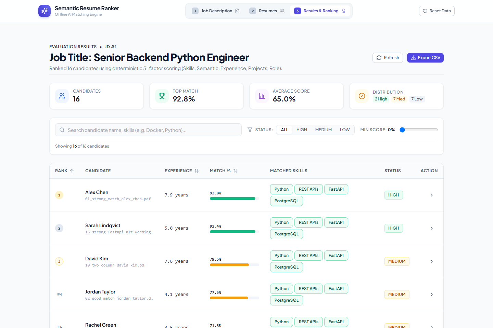
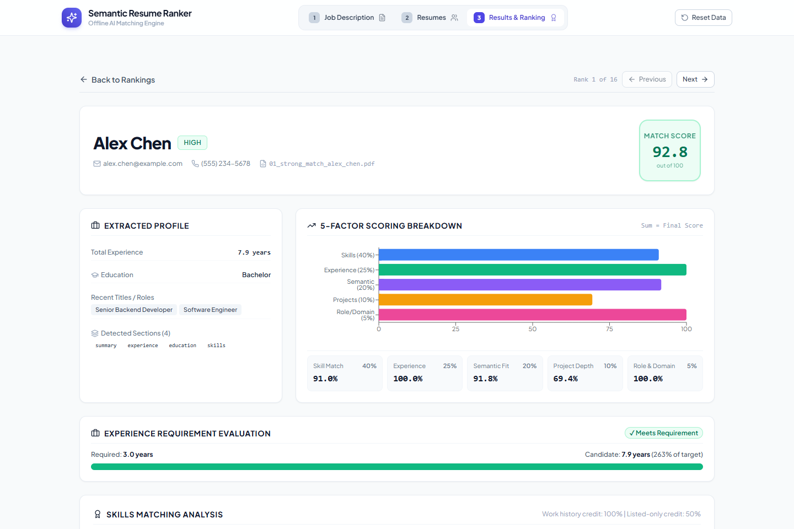
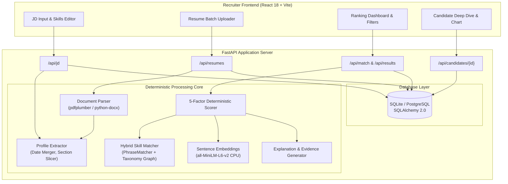

# AI-Based Resume Matching & Ranking System

An explainable, offline-first recruitment analytics platform that evaluates candidate resumes against Job Descriptions (JDs). It computes a calibrated **0–100 match score**, extracts matched and missing skills, verifies non-overlapping professional experience, and generates human-readable hiring rationales.

Built with **zero external LLM/API dependencies** — all natural language processing, semantic similarity, and scoring formulas run deterministically on local CPU.

---

## Visual Overview

<p align="center">
  
  
</p>

*Left: Candidate ranking dashboard with score distributions, status filters, and experience caps. Right: In-depth candidate evaluation with 5-factor breakdown, skill evidence attribution, and recruiter rationale.*

---

## Key Features (Mapped to Assignment Modules)

1. **Job Description Processing (Module 1)**:
   - Ingestion via raw text paste or file upload (`PDF`, `DOCX`, `TXT`).
   - Automated extraction of job title, minimum required experience, required and preferred skills, and degree requirements.
   - Recruiter override capabilities: interactive UI chip editor allowing recruiters to modify extracted requirements via `PUT /api/jd/{id}`.

2. **Resume Parsing & Entity Extraction (Module 2)**:
   - High-fidelity text extraction using `pdfplumber` and `python-docx`.
   - **Two-Column Layout Support**: Visual bounding-box coordinate sorting prevents text interleaving across columns.
   - **Total vs Relevant Experience & 3-Tier Explainable Role Relevance**:
     - Preserves verified total experience ($Y_{\text{tot}}$) from chronological date intervals.
     - Evaluates role relevance via three explainable tiers:
       - **Tier 1.0** (Full credit): $\ge 2$ JD skills demonstrated in title/bullets (exact, alias, or stemmed match; curated-related skills do not count as evidence).
       - **Tier 0.5** (Half credit): Exactly 1 JD skill demonstrated, OR 0 skills but bullet semantic cosine reaches threshold vs JD responsibilities ($\ge 0.55$).
       - **Tier 0.0** (No credit): Otherwise (e.g., non-technical roles or low semantic fit).
     - Slices overlapping periods into disjoint intervals taking active maximum relevance to prevent double-counting.
     - Strict invariant: $Y_{\text{rel}} \le Y_{\text{tot}}$ always holds.
   - **Comprehensive Education Hierarchy**: Evaluates Doctorate, Master's (`M.Sc.`, `M.S.`, `M.Tech`, `MBA`, `MCA`), Bachelor's (`B.Sc.`, `B.Tech`, `BCA`, `B.Com`), and Diploma; selects the highest degree when multiple are listed.
   - Graceful error handling for empty or scanned image PDFs (marked `parse_status = failed`, excluded from ranking; never crashes).

3. **Taxonomy, Open-Vocabulary & Hybrid Skill Matching (Module 3)**:
   - Curated taxonomy of canonical engineering, cloud, data science, and DevOps skills with aliases and curated relationships.
   - **Open-Vocabulary Extraction**: Captures bulleted and comma-separated skills under explicit headings even if not in the taxonomy.
   - **Required vs Preferred Deduplication**: Any skill appearing in both lists is retained exclusively in Required.
   - **Keyword-Stuffer Defense**: A skill found *only* in a "Skills" list receives reduced credit ($0.50$). A skill demonstrated in work history receives full credit ($1.00$).
   - **Curated Partial Credit Graph**: Explicit technical relationships (e.g., FastAPI $\leftrightarrow$ Flask/Django credit $0.60$, Docker $\leftrightarrow$ Podman $0.80$, PostgreSQL $\leftrightarrow$ MySQL $0.70$, scikit-learn $\leftrightarrow$ Machine Learning $0.70$, PyTorch $\leftrightarrow$ TensorFlow $0.70$).
   - **Embedding Fallback**: Cosine similarity via `all-MiniLM-L6-v2` triggered only for cosine $\ge 0.75$.

4. **Multi-Factor Deterministic Scoring (Module 4)**:
   - 5-factor calibrated formula:
     $$\text{FinalScore} = 0.40 \cdot \text{Skill} + 0.25 \cdot \text{Semantic} + 0.20 \cdot \text{Experience} + 0.10 \cdot \text{Education} + 0.05 \cdot \text{Project}$$
   - **Experience Score**: $S_{\text{experience}} = \min(Y_{\text{rel}} / Y_{\text{req}}, 1.0) \times 100.0$.
   - **Semantic Fit**: Sentence-level cross-similarity between JD requirements and resume experience, calibrated from $[0.28, 0.78]$ to $0-100\%$.
   - **Hard Experience Cap Rule**: If a candidate's relevant experience is $< 50\%$ of the stated requirement, their status label is capped at `LOW` (flagged `experience_cap_applied = True` only when the cap actively lowered the label from HIGH or MEDIUM).

5. **Explainability & Recruiter Dashboard (Module 5)**:
   - Categorized skills breakdown: Matched (with `Work` vs `Listed` badges), Partial (with source rule and credit %), and Missing.
   - Recharts visual bar chart of sub-scores.
   - Structured explanations: headline, positive/negative evidence bullets, and actionable hiring recommendations.
   - One-click CSV export (`/api/results/export.csv`) and sequential candidate cycling.

---

## Tech Stack

| Layer | Technologies |
|:---|:---|
| **Frontend** | React 18, Vite, TypeScript, Tailwind CSS, Recharts, Lucide Icons |
| **Backend** | Python 3.11+, FastAPI, Pydantic v2, SQLAlchemy 2.0 |
| **NLP & ML** | `sentence-transformers` (`all-MiniLM-L6-v2`, CPU), `spaCy` (`en_core_web_sm`) with `PhraseMatcher` |
| **Document Parsing** | `pdfplumber`, `python-docx` |
| **Database** | SQLite (default development), PostgreSQL (via `DATABASE_URL` in Docker/production) |
| **Quality & Tests** | `pytest`, `pytest-asyncio`, `ruff` (linter & formatter), ESLint |

---

## Architecture



---

## Quick Start

### Option A: Local Setup (Without Docker)

#### 1. Backend Setup

Create and activate a virtual environment:

```bash
# Create virtual environment
python -m venv backend/.venv

# Activate virtual environment
# Windows PowerShell:
.\backend\.venv\Scripts\Activate.ps1
# macOS / Linux:
source backend/.venv/bin/activate
```

Install dependencies and download the spaCy language model:

```bash
pip install -r backend/requirements.txt
python -m spacy download en_core_web_sm
```

Run the FastAPI application from the repo root:

```bash
uvicorn app.main:app --app-dir backend --host 127.0.0.1 --port 8000
```

> [!NOTE]
> On the first run, the backend automatically downloads the `all-MiniLM-L6-v2` model (internet needed once). Subsequent runs execute completely offline on local CPU.

API Documentation: `http://127.0.0.1:8000/docs`

#### 2. Frontend Setup
In a separate terminal:
```bash
cd frontend
npm install
npm run dev -- --host 127.0.0.1 --port 5173
```
Open `http://localhost:5173` in your browser.

---

### Option B (optional): Running with Docker Compose

The Docker setup is provided, but has not been tested on every platform.

```bash
docker compose up --build
```
- Frontend Web App: `http://localhost:5173`
- Backend API & Swagger: `http://localhost:8000/docs`

---

## Usage Walkthrough

1. **Step 1: Input Job Description**:
   - Paste job text, upload a document, or click **"Use Sample Python JD"** to test with the default role (3+ years experience, FastAPI, PostgreSQL, Docker).
   - Click **"Extract Requirements"** to parse required/preferred skills, experience thresholds, and responsibilities.
   - Review extracted skills. Add or delete skill chips as required, save corrections via **"Save Changes"** (or **"Save Corrections"**), and click **"Continue to Resumes"** / **"Proceed to Resume Upload"**.
2. **Step 2: Upload Resumes**:
   - Drag and drop resumes from `sample_data/resumes/` (supports batch upload up to 30 files, 5 MB limit).
   - View per-file parsing status in the table. Click **"Run Matching Engine"**.
3. **Step 3: Evaluate Rankings**:
   - Browse the ranked candidates table sorted by Match %.
   - Filter by status (`HIGH`, `MEDIUM`, `LOW`), filter by search keywords, or adjust the minimum score slider.
   - Click **"Export CSV"** to download the complete spreadsheet.
4. **Step 4: Candidate Deep Dive**:
   - Click on any candidate row to view the 5-factor breakdown chart, matched vs missing skills, and evidence bullets.
   - Use **"Next"** and **"Previous"** buttons to navigate through candidates sequentially.

---

## API Summary

| Method | Endpoint | Description |
|:---|:---|:---|
| `GET` | `/api/health` | Service health status, database connection, model loading state |
| `POST` | `/api/jd` | Create and parse Job Description (JSON body or file upload) |
| `GET` | `/api/jd/{id}` | Retrieve parsed Job Description details |
| `PUT` | `/api/jd/{id}` | Update Job Description skills, experience, or requirements |
| `POST` | `/api/resumes` | Batch upload and parse resumes (multipart PDF/DOCX) |
| `GET` | `/api/resumes` | List all parsed candidate summaries |
| `POST` | `/api/match` | Compute deterministic 5-factor match scores for all candidates |
| `GET` | `/api/results?jd_id={id}` | Retrieve ranked candidate list with summary metrics |
| `GET` | `/api/results/export.csv?jd_id={id}` | Download ranked results as a CSV spreadsheet |
| `GET` | `/api/candidates/{id}?jd_id={id}` | Retrieve full candidate analysis, sub-scores, and explanations |
| `DELETE` | `/api/reset` | Purge all database records for testing and clean demos |

---

## Project Structure

```
.
├── backend/
│   ├── app/
│   │   ├── main.py                     # FastAPI application lifespan & routing
│   │   ├── config.py                   # Calibrated thresholds and scoring weights
│   │   ├── db.py                       # SQLAlchemy 2.0 engine & session dependency
│   │   ├── models.py                   # Database entities (JD, Candidate, MatchResult)
│   │   ├── schemas.py                  # Pydantic v2 request/response schemas
│   │   ├── routers/                    # Endpoints (/jd, /resumes, /match)
│   │   └── services/                   # Parsing, NLP extractors, scorer, explainer
│   ├── data/skills_taxonomy.json       # 70+ canonical skills, 200+ aliases, relations
│   ├── tests/                          # Unit and integration pytest test cases
│   └── requirements.txt
├── frontend/
│   ├── src/
│   │   ├── pages/                      # JobDescriptionPage, ResumesPage, ResultsDashboard, CandidateAnalysis
│   │   ├── components/                 # AppShell, Card, Button, Badge, Chip, Toast
│   │   ├── api/client.ts               # Typed API client
│   │   └── types/index.ts              # TypeScript schemas matching backend Pydantic models
│   ├── package.json
│   └── tailwind.config.js
├── sample_data/
│   ├── job_description.txt             # Benchmark Senior Backend Python Engineer JD
│   ├── README.md                       # Synthetic personas and test set documentation
│   ├── resumes/                        # Synthetic test resumes (PDF & DOCX)
│   ├── data_scientist_test/            # Data Scientist JD and test resumes
│   ├── java_test/                      # Java / Spring Boot JD and test resumes
│   └── marketing_test/                 # Digital Marketing Manager JD and test resumes
├── scripts/
│   ├── capture_screenshots.cjs         # Headless browser screenshot capture script
│   └── test_e2e_flow.py                # Automated live end-to-end integration test
├── docs/
│   ├── ALGORITHM.md                    # In-depth algorithmic formula & worked example
│   └── screenshots/                    # High-resolution screenshots of the UI
├── docker-compose.yml
├── LICENSE                             # MIT License
└── README.md
```

---

## Testing & Quality Assurance

### Cross-Platform (macOS / Linux / Bash)

```bash
# 1. Run all backend tests
cd backend && pytest

# 2. Run Python lint and code style check
ruff check backend scripts

# 3. Run frontend TypeScript compiler and ESLint
npm --prefix frontend run build
npm --prefix frontend run lint

# 4. Run automated end-to-end live flow test
python scripts/test_e2e_flow.py
```

### Windows (PowerShell)

```powershell
# 1. Run all backend tests
.\backend\.venv\Scripts\python -m pytest backend/tests

# 2. Run Python lint and code style check
.\backend\.venv\Scripts\ruff check backend scripts

# 3. Run frontend TypeScript compiler and ESLint
npm --prefix frontend run build
npm --prefix frontend run lint

# 4. Run automated end-to-end live flow test
.\backend\.venv\Scripts\python scripts/test_e2e_flow.py
```

---

## Limitations

- **Synthetic Data**: All resumes across the benchmark sets (Python/FastAPI, Java/Spring Boot, Data Scientist, and Digital Marketing) are synthetically generated personas using `@example.com` domains designed to evaluate edge cases (career changers, keyword stuffers, freshers, format variations).
- **Calibration on Sample Set**: Calibration ranges (semantic cosine min/max $[0.28, 0.78]$, experience relevance min/max $[0.35, 0.55]$, and status thresholds at 60/80) were tuned specifically on benchmark corpora and should be re-calibrated on real-world applicant distributions.
- **Thresholds are Heuristics**: The 5-factor scoring weights (0.40 / 0.25 / 0.20 / 0.10 / 0.05) and calibration cutoffs are deterministic engineering heuristics rather than learned parameters from large-scale labeled hiring outcomes.
- **Skill Matching for Untaxonomized Domains**: For domains without explicit taxonomy coverage or curated relationship entries, skill matching depends on exact/alias string matches plus an embedding fallback with a strict threshold of cosine $\ge 0.75$ on short skill names. As a result, paraphrased skills (e.g., "Newsletter marketing" for "Email Marketing", "Split testing" for "A/B Testing") may receive no skill credit even though the holistic semantic component still recognizes the alignment in work history.
- **Listed-Only Skills & Keyword Stuffers**: Skills that appear only in a resume's skills list retain partial credit (0.50 multiplier). Consequently, a keyword stuffer listing numerous unverified skills can occasionally outscore an honest candidate from a completely different domain; the system's keyword stuffing badge (`KEYWORD_STUFFING`) flags this behavior when $\ge 8$ matched skills are listed-only, comprising $\ge 70\%$ of matches with $< 2$ demonstrated skills.
- **Single Generic Skill in Role Relevance**: Under the 3-tier role relevance rule, demonstrating $\ge 1$ JD skill in a role's title or bullets awards Tier 0.5 (half-credit) for that tenure. If that single demonstrated skill is an ubiquitous, generic skill (such as `Git`, `REST APIs`, or `SQL` in a Digital Marketing JD), an applicant from a different technical field (e.g., a backend software engineer with `SQL`) can earn 50% relevance tenure for a marketing role. Future revisions could introduce a differentiated 'generic skills' discount or require core stack demonstration for tier qualification.
- **English Only**: The parsing regexes, date extractors, spaCy pipeline (`en_core_web_sm`), and sentence transformer model (`all-MiniLM-L6-v2`) target English-language resumes and JDs; multilingual parsing is not supported.
- **No OCR Support**: The parser relies on native digital text layers in PDFs and DOCX files. Scanned documents or image-only PDFs (such as `13_scanned_empty_edge_case.pdf`) are caught gracefully and marked with `parse_status = failed` without crashing, but optical character recognition (OCR) is out of scope.
